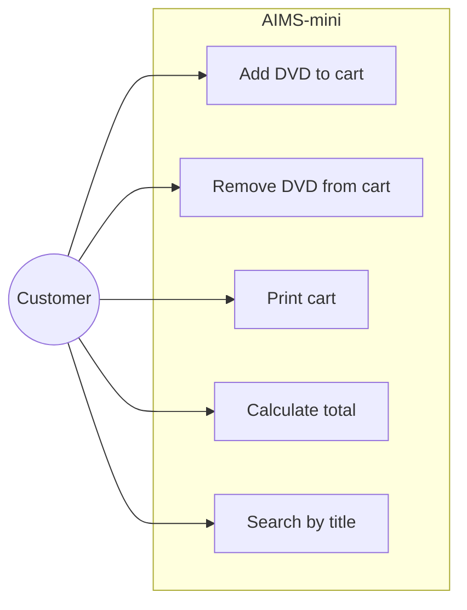

# Lab 02 — AIMS-mini use-case specification

## Actors and scope

**Customer** uses the command-line shopping cart. The mini application has no database, authentication, or checkout/payment gateway.

## UC01 — Add DVD

**Precondition:** A cart instance exists and a valid DVD has been selected.

**Main flow:** Customer selects DVD → system checks the 20-item limit → system adds the DVD → returns success.

**Alternate flow:** When the cart already contains 20 DVDs, return `False` without modifying `items`.

**Postcondition:** The DVD is added exactly once if successful.

## UC02 — Remove DVD

**Precondition:** A cart exists.

**Main flow:** Customer selects a DVD currently in cart → system removes it → returns `True`.

**Alternate flow:** DVD absent → returns `False`, list unchanged.

## UC03 — Print cart

**Main flow:** System prints ordered DVDs and total cost.

**Alternate flow:** Empty cart → print `The cart is empty`.

## UC04 — Calculate total

Sum the costs of all items. An empty cart has total 0.0.

## UC05 — Search by title

Compare substring without distinguishing uppercase/lowercase. Return all matches without mutating the original list; empty keyword lists all items.

## Change-control note

Use this specification to validate PRs implementing each feature. Any difference between current code and expected alternate flow must be tracked as a test/fix rather than silently treated as complete.
