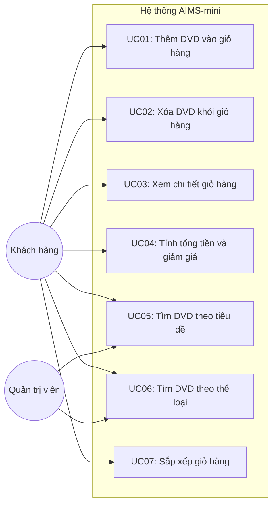

# Đặc tả ca sử dụng (Use Case Specification) — AIMS-mini

**Học phần:** IT3180 — Nhập môn Công nghệ phần mềm  
**Sinh viên:** Nguyễn Văn Sơn — MSSV 202416339

## 1. Phạm vi và tác nhân

AIMS-mini là ứng dụng mẫu Python chạy trên dòng lệnh để thực hành quản lý cấu hình phần mềm. Các thao tác dưới đây được cung cấp dưới dạng hàm/phương thức trong `aims/`; `main.py` chỉ trình diễn thêm DVD, tính tiền và in giỏ hàng, **không** phải giao diện tương tác đầy đủ.

- **Khách hàng:** thực hiện các nghiệp vụ giỏ hàng và tra cứu DVD.
- **Quản trị viên (minh họa):** có thể tra cứu theo danh mục/tiêu đề trong mô hình ca sử dụng. Chương trình hiện chưa có đăng nhập hoặc phân quyền quản trị.

## 2. Biểu đồ Use Case tổng quan

## 3. Đặc tả các ca sử dụng

### UC01 — Thêm DVD vào giỏ hàng

- **Tác nhân:** Khách hàng.
- **Tiền điều kiện:** Có đối tượng `Cart` và `DigitalVideoDisc` hợp lệ.
- **Luồng chính:** Gọi `Cart.add_dvd(dvd)`; nếu số đĩa nhỏ hơn `MAX_NUMBERS_ORDERED = 20`, thêm DVD, in thông báo `Đã thêm đĩa vào giỏ hàng` và trả về `True`.
- **Ngoại lệ:** Khi giỏ đã có 20 đĩa, trả về `False`; không thêm DVD thứ 21.

### UC02 — Xóa DVD khỏi giỏ hàng

- **Tác nhân:** Khách hàng.
- **Luồng chính:** Gọi `Cart.remove_dvd(dvd)`; nếu đĩa tồn tại, xóa khỏi `items` và trả về `True`.
- **Ngoại lệ:** Không có DVD cần xóa: trả về `False`, danh sách không đổi.

### UC03 — Hiển thị chi tiết giỏ hàng

- **Tác nhân:** Khách hàng.
- **Luồng chính:** `Cart.print_cart()` in danh sách theo thứ tự, thông tin DVD và tổng tiền với hai chữ số thập phân.
- **Ngoại lệ:** Giỏ rỗng: in `The cart is empty`.

### UC04 — Tính tổng tiền và giảm giá

- **Tác nhân:** Khách hàng.
- **Luồng chính:** `Cart.total_cost()` cộng chi phí các DVD. `Cart.total_cost_with_discount(percent)` trả về `total × (100 - percent) / 100`.
- **Điều kiện hợp lệ:** `0 ≤ percent ≤ 100`.
- **Ngoại lệ:** Tỷ lệ nằm ngoài khoảng này: phát sinh `ValueError`. Giỏ rỗng có tổng tiền bằng 0.

### UC05 — Tìm kiếm DVD theo tiêu đề

- **Tác nhân:** Khách hàng; Quản trị viên (mô hình).
- **Luồng chính:** `search_by_title(items, keyword)` trả về các DVD có tiêu đề chứa từ khóa, không phân biệt hoa/thường.
- **Ngoại lệ:** Từ khóa rỗng trả về bản sao toàn bộ danh sách; từ khóa không phải chuỗi phát sinh `TypeError`.

### UC06 — Tìm kiếm DVD theo thể loại

- **Tác nhân:** Khách hàng; Quản trị viên (mô hình).
- **Luồng chính:** `search_by_category(items, category)` lọc theo chuỗi con trong `dvd.category` và không phân biệt hoa/thường.
- **Ngoại lệ:** Chuỗi rỗng trả về bản sao danh sách; đầu vào không phải chuỗi phát sinh `TypeError`.

### UC07 — Sắp xếp giỏ hàng

- **Tác nhân:** Khách hàng.
- **Theo tên:** `Cart.sort_by_title()` sắp xếp tiêu đề tăng dần không phân biệt hoa/thường; nếu trùng tên, giá giảm dần.
- **Theo giá:** `Cart.sort_by_cost()` sắp xếp giá giảm dần; nếu trùng giá, tên tăng dần.
- **Hậu điều kiện:** Các thao tác thay đổi thứ tự `Cart.items` ngay trên giỏ, không thêm hoặc xóa DVD.

## 4. Liên hệ mã nguồn và kiểm thử

| Thành phần | Chức năng | Kiểm thử |
|---|---|---|
| `aims/cart.py` | UC01, UC02, UC03, UC04, UC07 | `tests/test_cart.py`, `test_discount.py`, `test_sort.py` |
| `aims/search.py` | UC05, UC06 | `tests/test_search.py`, `test_category.py` |
| `aims/dvd.py` | Dữ liệu DVD, giá không âm và hữu hạn | `tests/test_dvd.py` |
| `main.py` | Chương trình demo | `python main.py` — tổng 63.89 USD |

**Lưu ý:** Đây là sơ đồ chức năng của mô hình AIMS-mini phục vụ Lab 02, không phải giao diện người dùng hay hệ thống phân quyền đã triển khai.
